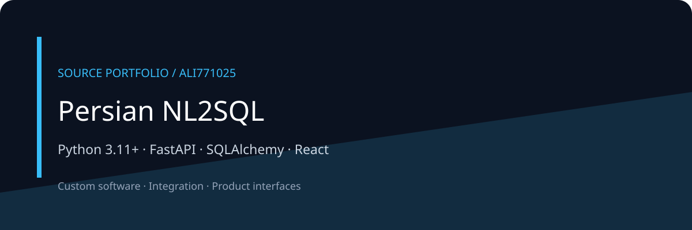

# Persian NL2SQL



A Python service for translating Persian analytical questions into SQL through schema retrieval and policy checks.

[معرفی فارسی](docs/README.fa.md) · [Architecture](docs/ARCHITECTURE.md) · [Discuss a project](https://github.com/Ali771025)

## What this portfolio shows

- Schema retrieval, planning and SQL validation modules are explicit in the source.
- Optional embedding, reranking, Qdrant, Neo4j and Redis integrations.
- A browser frontend and command-line entrypoint support query workflows.

## Technology

Python 3.11+ · FastAPI · SQLAlchemy · React

## Local orientation

These are source-derived starting commands, not a verified deployment recipe. Review configuration and dependencies first.

```bash
python -m venv .venv
source .venv/bin/activate
pip install -e .
export NL2SQL_EMBEDDING_PROVIDER=feature_hash
export NL2SQL_RERANKER_PROVIDER=lexical
PYTHONPATH=app uvicorn nl2sql.main:app --reload
```

All credentials, infrastructure and datasets must be supplied independently. See configuration modules for required variables. Binary assets and customer documents are deliberately absent; some visual asset references may need replacements.

## Edition and verification

This is a compact public source edition. Original history, contracts, private documents, databases, logs, generated output and dependency directories are excluded. No build, test, deployment, security certification or production-readiness claim is made for this edition. Public documentation and diagrams describe source structure; they are not application screenshots.

## Work together

For a related product, integration or custom workflow, [contact Ali through GitHub](https://github.com/Ali771025). Share your intended users, workflow and integration needs to scope the work.

No new license grant is added by this portfolio edition. Third-party components remain subject to their own terms.
