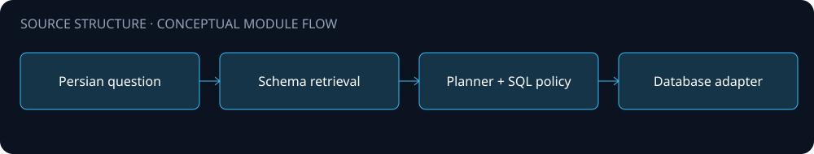

# Architecture

A Python service for translating Persian analytical questions into SQL through schema retrieval and policy checks.

The diagram is a source-level orientation. Arrows describe intended module relationships; integration availability and end-to-end behavior were not validated for this public edition.

## Boundaries

- Schema retrieval, planning and SQL validation modules are explicit in the source.
- Optional embedding, reranking, Qdrant, Neo4j and Redis integrations.
- A browser frontend and command-line entrypoint support query workflows.

## Configuration and data

Configure your own environment and service endpoints. Never place API keys, production connection strings, customer records or uploaded documents in this repository. Public source omits operational assets and does not include a production deployment guarantee.
